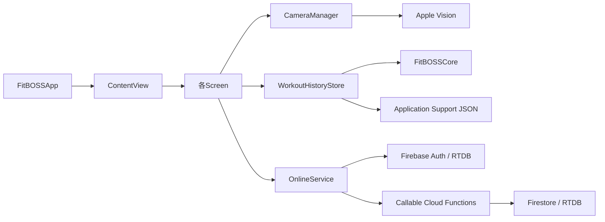

# FitBOSS コードの読み方・構成ガイド

> 対象: macOS SwiftUI アプリ + Firebase オンライン機能のソース。
> この文書はアーキテクチャの見取り図です。正式リリース・本番デプロイ手順ではありません。

## 最初に読む順序

1. `Sources/FitBOSSApp/FitBOSSApp.swift` — macOS アプリの入口。各ウィンドウで**共通の** `WorkoutHistoryStore` を使う。
2. `Sources/FitBOSSApp/ContentView.swift` — サイドバーと8画面の遷移、前面画面の更新・保留アップロードの再送。
3. `Sources/FitBOSSApp/Screens/` — 画面ごとのUI。画面設計を調整するときはここから読む。
4. `Sources/FitBOSSApp/WorkoutCameraView.swift` → `CameraManager.swift` → `VisionPoseDetector.swift` — カメラ取得と姿勢推定。生映像・関節座標は端末内。
5. `Sources/FitBOSSApp/WorkoutHistoryStore.swift` → `Sources/FitBOSSCore/WorkoutHistory*.swift` — 運動記録・休息日・ファイル保存・移行。
6. `Sources/FitBOSSApp/OnlineService.swift` — Googleログイン、チーム/対戦API、RTDB Presence。まず `// MARK:` をたどる。
7. `functions/src/domain.js` → `functions/src/index.js` — Firebase Functions側の入力検査・認可・ドメイン処理（本番Functionsは未デプロイ）。

## macOS側のファイル責務

| 場所 | 責務 | 原則 |
| --- | --- | --- |
| `FitBOSSApp.swift` | アプリ起動・共有ストアの生成 | 履歴ストアをウィンドウ別に作らない |
| `ContentView.swift` | ナビゲーション、画面切替、画面表示中の通信制御 | 個別画面のUIは書かない |
| `Components/ScreenComponents.swift` | 見出し付きレイアウト、統計カード、情報パネル | 表示専用の共通部品 |
| `Screens/HomeScreen.swift` (`BOSSHomeScreen`) | ネオンのホーム統計、保存履歴、各画面の入口 | 計算・保存はStore/Coreへ |
| `Screens/BattleScreen.swift` (`BOSSBattleScreen`) | ルーム作成、参加、進捗、再戦 | 操作はOnlineServiceへ |
| `Screens/TeamScreen.swift` | チーム作成/参加、Presence、ランキング | 表示とサーバー側権限制御を混同しない |
| `Screens/AchievementsScreen.swift` | 未達成バッジの表示 | 仮の獲得実績を作らない |
| `Screens/SettingsScreen.swift` | 認証状態、ユーザー向けプライバシー説明 | 説明を実装に一致させる |
| `OnlineService.swift` | 認証、Cloud Functions呼び出し、RTDB接続状態 | カメラ映像や関節座標を送らない |
| `WorkoutHistoryStore.swift` | 端末内履歴と送信待ちキュー | 保存失敗なら既存データ保護 |
| `FitBOSSCore/` | 運動の評価、JST日付/休息日、履歴、送信リクエスト方針 | SwiftUI / Firebase に依存させない |

## データの経路



**重要:** CameraManager/Apple VisionからFirebaseへ、映像や姿勢座標を送る経路を作らないこと。クラウドへ送信する可能性があるのは、認証済みのチーム利用時の運動完了サマリー・参加/接続情報など。Firestore/RTDBの認可の正本はサーバーであり、UIボタンのdisabledではない。

## 2種類のビルド

| 設定 | モード | 主な用途 |
| --- | --- | --- |
| `bash Scripts/build-app.sh` | 通常のオフライン版 | ローカル計測と履歴 |
| `FITBOSS_FIREBASE_ENABLED=1 swift build -c debug --product FitBOSSApp` | Firebase/Google SDK有効コンパイル | SDKの互換性確認（実際のGoogleログインにはローカル設定と署名が必要） |

`Scripts/create-dmg.sh` は**オフライン内部テスト用**。PR #6でビルド種別の安全確認を追加中であり、PR #6の取り込み前後で挙動が異なる点に注意。公開版はDeveloper ID署名・公証なしには完成しない。

## 読みやすさを保つルール

- **1画面 = 1ファイル。** 画面遷移だけ `ContentView` に残す。
- 通信・保存・UI描画の責務を混ぜない。ボタンからバックエンドを直接書き換えない。
- SwiftUIに返す観測状態は `@Published`、長期保存は `WorkoutHistoryStore` と `FitBOSSCore` に分離する。
- コメントは **「なぜそうするか」や制約** を書く。変数名の読み上げにしない。
- 同じ行へ複数の状態更新を詰め込まず、状態ごとに独立した行へ展開する。
- 既存の公開インターフェース、UserDefaults移行、JSTの扱い、運動記録のJSON形式は、単なる整形のために変更しない。
- Firebaseへのデプロイ、Blaze変更、正式Release公開は、独立した承認と検証を必要とする。

## 既存テストと検証範囲

```bash
swift test                       # 運動判定、履歴保存、複数ウィンドウ、リクエスト方針
bash Scripts/build-app.sh        # macOSでの通常版アプリ生成
FITBOSS_FIREBASE_ENABLED=1 swift build -c debug --product FitBOSSApp
```

CI: `.github/workflows/manual-macos.yml`（macOS/Swift、Nodeドメイン、Firebase統合など）、`.github/workflows/macos-dmg.yml`（内部DMG）。このリファクタリングでは本番Firebaseに変更しない。機能面の手動カメラテスト・実Googleログイン・DMGの一般配布は別検証。

**関連資料:** [ARCHITECTURE](ARCHITECTURE.md) / [FIREBASE_SETUP](FIREBASE_SETUP.md) / [BETA_READINESS](BETA_READINESS.md)
